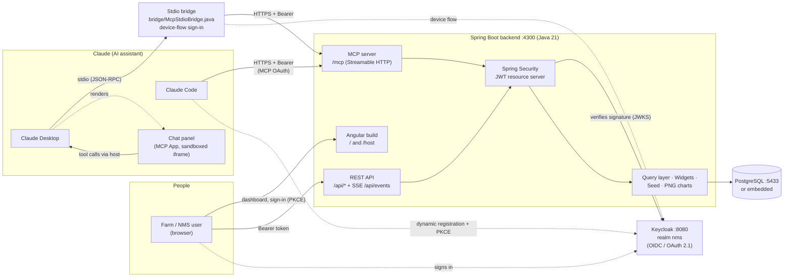
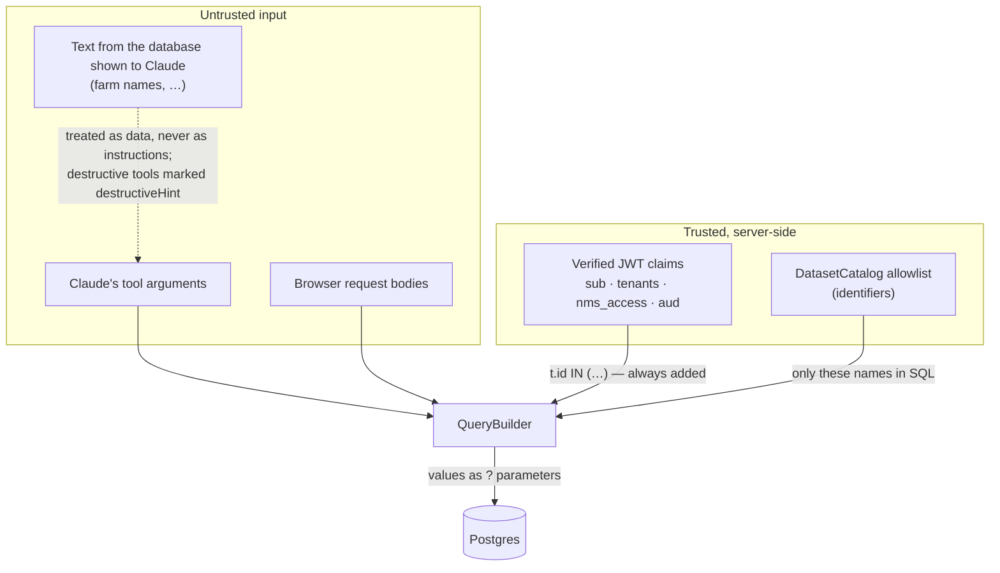
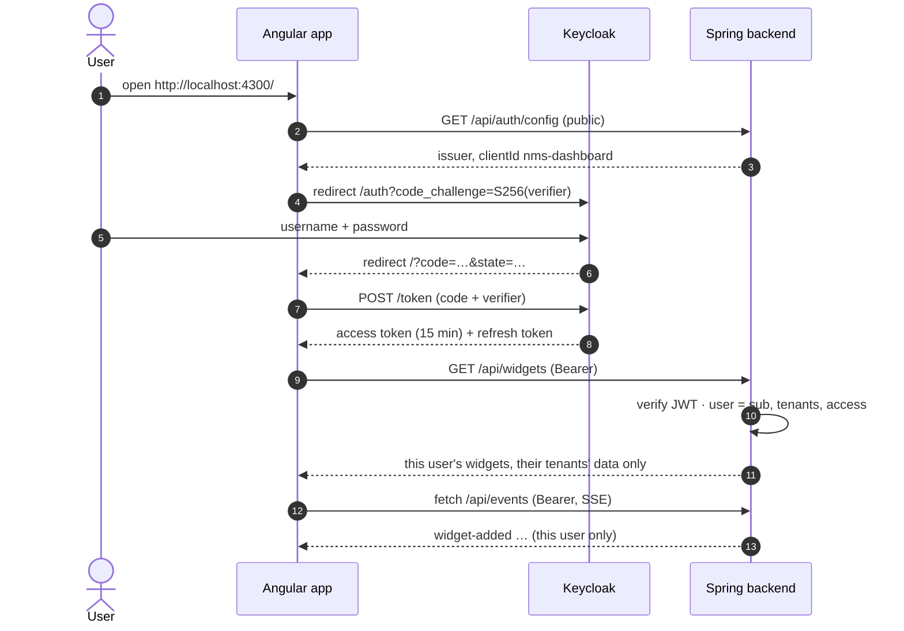
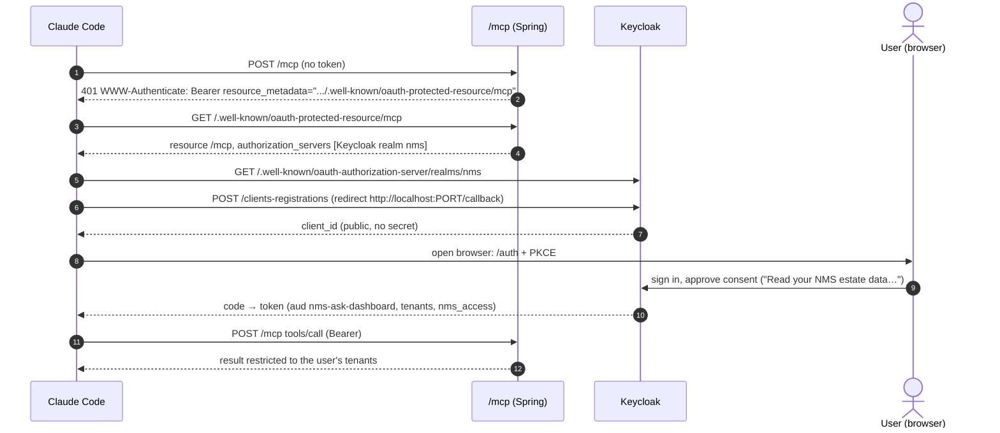
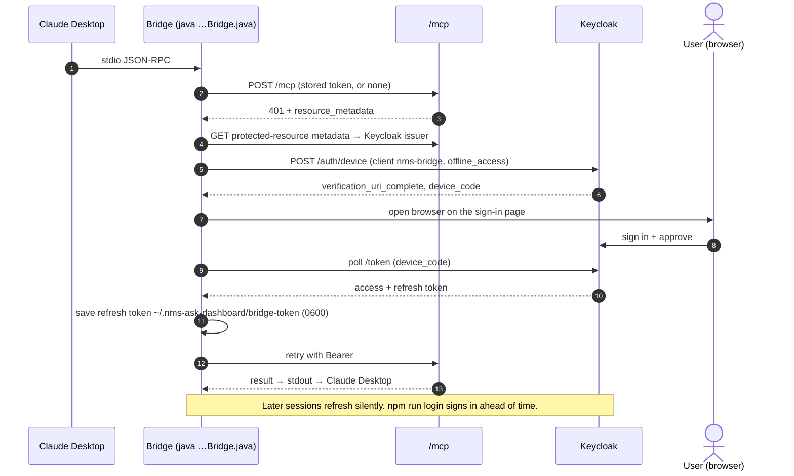
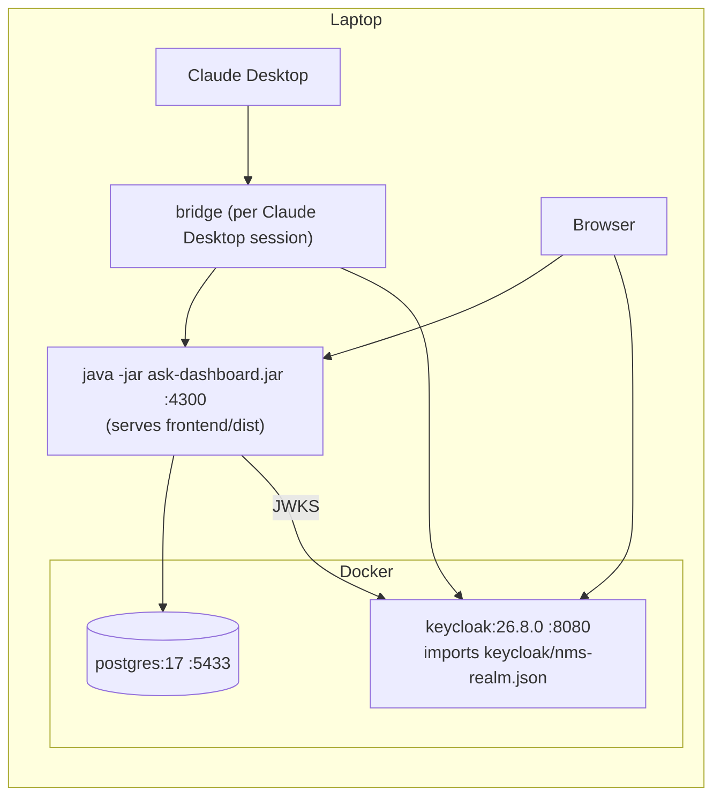
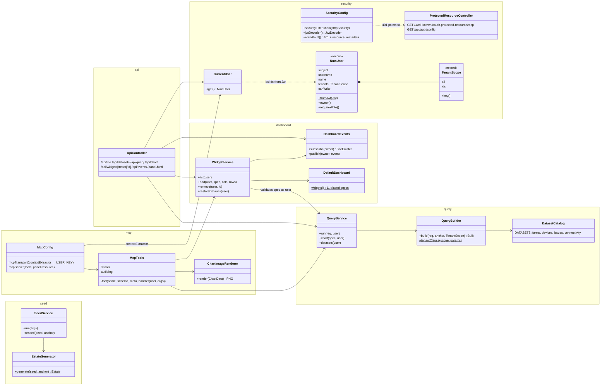
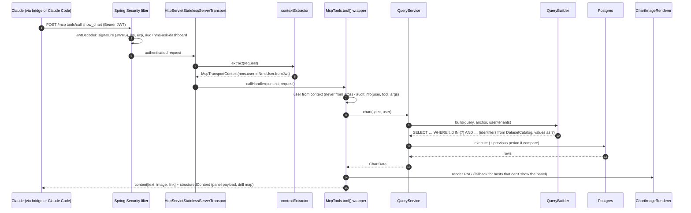
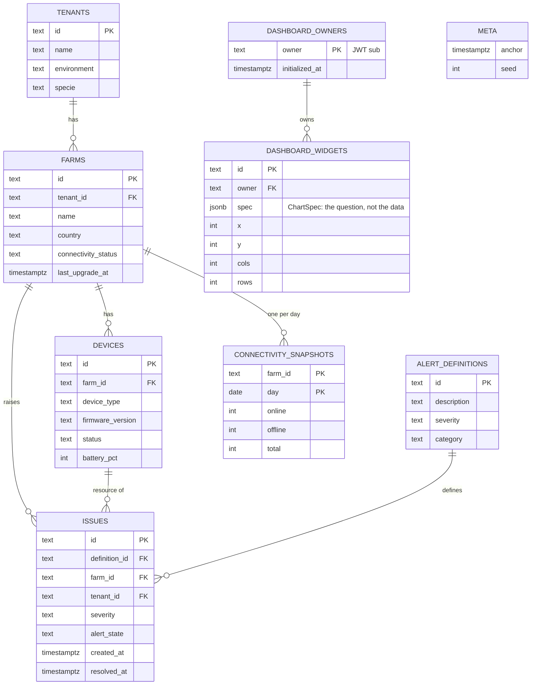
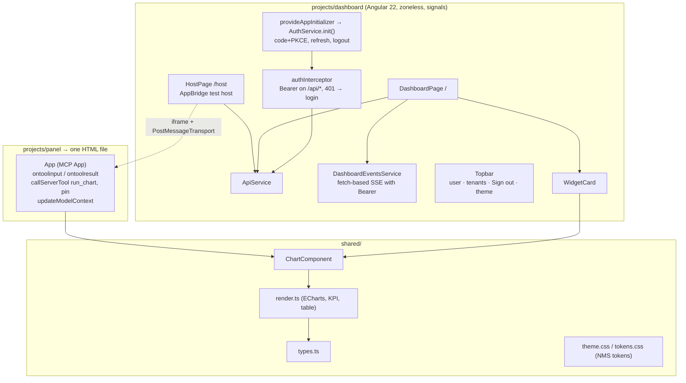

# NMS Ask the Dashboard: architecture

This document has two parts:
- **High-level design (HLD):** the system's parts and how they connect, including how each kind of client signs in.
- **Low-level design (LLD):** the backend's classes, the request path through them, the data model and the frontend components.

The diagrams are Mermaid, which renders on Azure DevOps, GitHub and in Mermaid-enabled editors. PNG exports for slides are in [`diagrams/`](diagrams/).

---

## 1. High-level design

### 1.1 System context

**Responsibilities:**

| Part | Owns | Does not |
|---|---|---|
| **Keycloak** | Users, passwords, sign-in pages, consent, token issuing. Claims: `tenants`, `nms_access`, `aud`. | Hold any NMS data |
| **Spring Security** | Verifying every `/api` and `/mcp` token: signature, issuer, expiry, audience | Decide *what* data a user sees. That's the query layer, from the token's claims. |
| **REST API** | The dashboard's contract: queries, charts, widgets, live events | Trust tenant or user values from request bodies |
| **MCP server** | The 9 tools Claude can call, plus the panel resource | Run SQL directly; it calls the same services as REST |
| **Query layer** | Turning a question into one parameterised SQL statement, always restricted to the caller's tenants | Accept SQL from Claude |
| **Bridge** | Relaying stdio to `/mcp` for Claude Desktop; signing in with the device flow | Store passwords. It keeps only a refresh token, readable by the user only. |
| **Chat panel** | Drawing charts in the chat; drill-down; pin | Hold a token. Its calls ride on Claude's signed-in connection. |

### 1.2 Trust boundaries

### 1.3 Sign-in flows

**(a) Dashboard in the browser: authorization code + PKCE**

**(b) Claude Code: MCP authorization (OAuth 2.1, RFC 9728 + RFC 7591)**

**(c) Claude Desktop through the stdio bridge: device authorization grant (RFC 8628)**

### 1.4 Deployment (local / demo)

**For production:**
- TLS in front of everything.
- Keycloak replaced by the company's Okta or Entra ID; only the issuer URL changes.
- Managed Postgres, with a read-only role for queries.
- No bridge: Claude connects to `https://…/mcp` as a remote connector.
- The `audit` logger shipped to the SIEM.

---

## 2. Low-level design

### 2.1 Backend classes

### 2.2 One MCP call through the layers: `show_chart`

### 2.3 Authorization rules

| Action | REST | MCP tool | Needs |
|---|---|---|---|
| See data, charts, dropdown values | `/api/query`, `/api/chart`, `/api/datasets` | `query_data`, `show_chart`, `run_chart`, `list_datasets` | Valid token. Rows limited to `tenants` |
| See own dashboard | `/api/widgets`, `/api/events` | `list_dashboard`, `show_widget` | Valid token. Only the user's own widgets |
| Change dashboard | `POST/DELETE /api/widgets`, `/reset` | `pin_to_dashboard`, `create_dashboard`, `remove_widget` | `nms_access = write` (otherwise 403 / tool error) |
| Discover sign-in | `/.well-known/oauth-protected-resource/mcp`, `/api/auth/config` | n/a | Public |
| Discover the MCP server | n/a | `initialize`, `ping`, `tools/list`, `resources/list`, `resources/read` (the panel HTML) | Public, but only for requests with **no** `Authorization` header (`McpDiscoveryFilter`), so Claude starts without a sign-in. Any `tools/call` needs a token. |
| App shell, panel HTML | `/`, `/host`, `/panel.html` | n/a | Public (no data) |

**Token claims** (Keycloak client scope `nms`, a default for every client, including self-registered ones):

| Claim | Example | Used for |
|---|---|---|
| `aud` | `nms-ask-dashboard` | Rejects tokens issued for other apps |
| `sub` | `8f209b63-…` | Dashboard owner |
| `tenants` | `["77c2c8fc-…"]` or `["*"]` | `TenantScope`, which becomes `t.id IN (…)` |
| `nms_access` | `write` / `read` | `canWrite` |
| `preferred_username`, `name` | `dairyprod`, `Dairy Prod User` | Audit log, top bar |

### 2.4 Data model

Flyway migrations: `V1__estate.sql` (estate and widgets) and `V2__dashboards_per_user.sql` (owner column and `dashboard_owners`).

### 2.5 Frontend

---

## 3. Design decisions

| Decision | Why |
|---|---|
| **The tenant restriction lives in `QueryBuilder`**, and `build()` has no unrestricted variant | One choke point for REST, MCP, the panel and dashboard widgets. It can't be forgotten. |
| **The user reaches tools through the MCP transport context** | Tools can't be talked into acting as another user through their arguments |
| **Stateless MCP transport** | No session to keep or leak; every request carries its own token |
| **MCP discovery open, tool calls protected** | Claude Desktop lists tools at start-up. Requiring a token there would open the sign-in page with the app rather than with the first question. The tool list and panel HTML hold no estate data. |
| **Widgets store the question (`ChartSpec`), not the data** | Always live; re-run in the viewer's tenant scope |
| **Bridge with device flow** for Claude Desktop | Desktop can't run OAuth for stdio servers. The device flow needs no local web server or secret. |
| **Public clients + PKCE**, no client secrets in the browser, bridge or Claude | Nothing secret to leak from a laptop |
| **Keycloak locally; Okta or Entra ID in production** | Standard OIDC. Only `OIDC_ISSUER` and the claim mappers change. |
